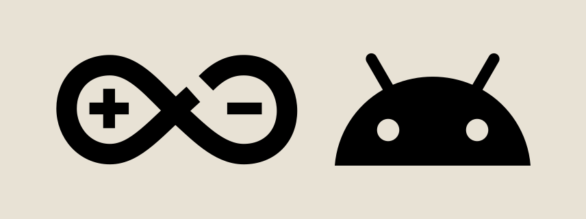

<p align="center">
  
</p>

<h1 align="center">RhineDroid</h1>

<p align="center">
  <a href="README.md">简体中文</a> · English
</p>

<p align="center">
  
  
  
  
  
  
</p>

RhineDroid is an Android port of [Rhine-Music-Demo](https://github.com/RonaldDeng/Rhine-Music-Demo) for browsing and playing local music on a 3D album shelf. Its interface design comes from [RhineLabUI](https://github.com/LBEILC/RhineLabUI). This branch independently maintains the Android adaptation.

## Implemented features

| Feature | Details |
| --- | --- |
| 3D album shelf | Native Filament / Vulkan GPU rendering with acrylic cases, transparent inner panels, spine and top-edge highlights, gentle blur outside the focus area, and an opening wave animation. Supports swipe navigation, album extraction and return, and a thumbnail overview. |
| Local library | Scan the Android media library or add music folders through the system file picker. Reads audio tags and artwork, caches the index, and reuses scan results for unchanged files. |
| Search and organization | Search albums and tracks and locate them on the shelf. Arrange the library by genre, artist, or album, and customize local genre classifications. |
| Music playback | AndroidX Media3 playback for common formats such as FLAC, MP3, and M4A, with album queues, previous / next track controls, seeking, volume adjustment, and configurable fades when changing tracks. |
| Background and device controls | Background playback, notification and lock-screen controls, system audio focus handling, and preferred audio output selection. Android determines the actual output route. |
| Interface and motion | Immersive landscape and portrait layouts, orientation transitions, day and night themes, an expandable now-playing card, and separately adjustable interface sounds and ambient music. |
| Album information | On-demand album introductions, genres, and credits, with cached results and source attribution. Local playback works independently of these online services. |
| Diagnostics | Export a runtime log ZIP from the app with device information, rendering state, and recent errors to help investigate device-specific issues. |

## Usage

Requires Android 8.0 or later and Vulkan 1.1 support. The project is still in testing; actual audio format support depends on device decoding capabilities.

The application ID is `com.enc3l.rhinedroid`, or `com.enc3l.rhinedroid.rc` for the RC build. It installs separately from builds using the previous package ID. Settings and library indexes do not migrate automatically; grant access and scan your music again on first use.

1. Install the APK, open the music library, and grant access to device audio or add a music folder. Media library scanning suits large collections already indexed by Android; the first folder import also needs to read audio tags.
2. Swipe through the shelf to select an album, or find a track through search. Open an album and tap a track to play.
3. Tap the track name in the top bar to expand the now-playing card and adjust playback position or volume. Tap its track information to collapse it.
4. Use settings to change the theme, adjust sounds, or query album information. Removing an added folder revokes access and removes its index; it does not delete music files.

Local scanning and playback work offline. Online album information is optional, and music files stay on the device.

## Build locally

### Prerequisites

| Tool | Requirement |
| --- | --- |
| JDK | 17, with `JAVA_HOME` pointing to the JDK directory. |
| Node.js | 22.12.0 or later, including npm. |
| Android SDK | Platform 37, Build Tools 36.0.0, and Platform Tools, available through Android Studio's SDK Manager. |
| Bash | 4 or later. WSL2 is recommended on Windows; macOS needs a newer Bash installed separately. |

Set `ANDROID_HOME` to the Android SDK directory, or create `local.properties` in the project root with `sdk.dir=/path/to/Android/SDK`. Add the SDK's `platform-tools` directory to `PATH` to use `adb`. The project includes the Gradle Wrapper, so a separate Gradle installation is unnecessary. The first build needs internet access to download dependencies.

### Build and install

After cloning or downloading the project, run this command from the root directory containing `gradlew`:

```bash
bash scripts/build-apk.sh
```

The script installs Web dependencies, runs the relevant checks and native unit tests, builds the APK, and runs Android Lint. Gradle builds the Web assets and album shelf mesh automatically; no manual copying is needed.

The current version produces `deliverables/RhineDroid-v0.4.8-debug.apk`. Connect a device with USB debugging enabled and authorized, then install it:

```bash
adb install -r deliverables/RhineDroid-v0.4.8-debug.apk
```

Use `bash scripts/build-apk.sh rc` for the experimental optics build. It produces `deliverables/RhineDroid-v0.4.8-rc.apk` with a separate package ID, so both variants can be installed together. Both use a local debug signature; installing over an existing build requires a matching signature.

You can also install the Web dependencies and build directly with Gradle:

```bash
npm ci --prefix web
npm run check --prefix web
./gradlew :app:testDebugUnitTest :app:assembleDebug :app:lintDebug
```

This produces `app/build/outputs/apk/debug/app-debug.apk`.

## Feedback

When opening an issue in this repository, include the device model, system version, and reproduction steps. Export a runtime log ZIP from the diagnostics section in settings. Logs may contain filenames, so review them before sharing publicly.

## Credits and license

Thanks to [RonaldDeng / Rhine-Music-Demo](https://github.com/RonaldDeng/Rhine-Music-Demo) for the music-player design and interactions, and [LBEILC / RhineLabUI](https://github.com/LBEILC/RhineLabUI) for the original 3D interface and motion foundation.

Code retains the [MIT License](LICENSE) and original copyright notices. See [NOTICE.md](NOTICE.md) for the sources and rights of the logo, fonts, third-party dependencies, and original-work assets. RhineDroid is an unofficial derivative project.
